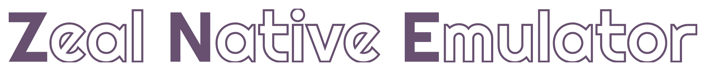
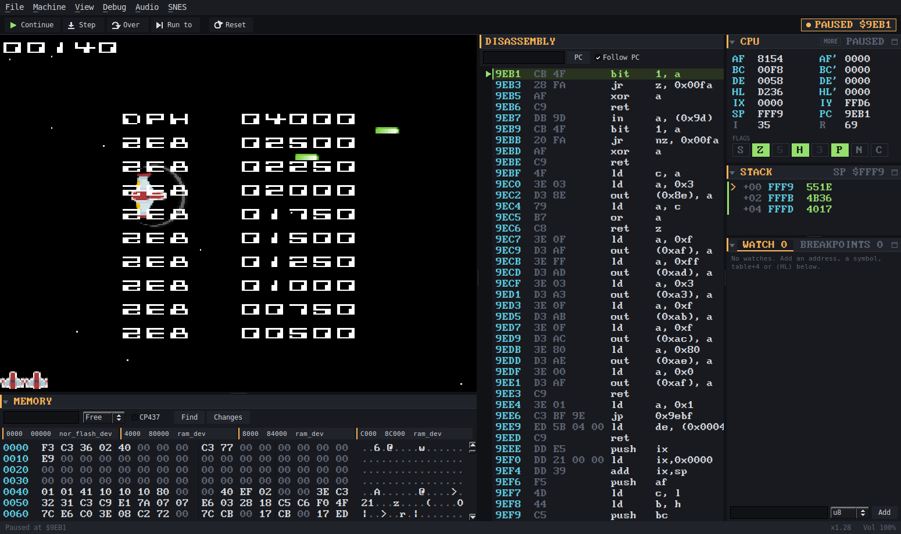

<center>
    
</center>

<center>
    
</center>

This project is a software emulator for Zeal 8-bit Computer: a homebrew 8-bit computer based on a Z80 CPU.

The emulator core is written in C, and runs natively on desktop platforms. It uses a CPU software renderer, and is designed to precisely replicate the behavior of the original hardware.

Whether you're developing software for Zeal 8-bit Computer or just using it to execute existing software, this emulator provides a fast and flexible environment for running and testing your code.

## Why this project?

An emulator for the Zeal 8-bit Computer already exists: it's called [Zeal-WebEmulator](https://github.com/Zeal8bit/Zeal-WebEmulator). That emulator is also public and open-source. To make it easily accessible without requiring any installation, it was developed in JavaScript and runs entirely in the web browser. However, due to this implementation choice, it struggles to maintain full speed and deliver a native-like experience when running Z80 CPU-intensive programs.

That's where the **Zeal Native Emulator** comes in! The emulator renders frames on the CPU. The desktop frontend displays them with FLTK and uses SDL3 for audio and gamepads.

Thanks to its native implementation, this emulator is also much more portable, it can be adapted to other platforms including (but not limited to) WASM and Android. See the [Ports](#ports) section for more details.

Additionally, because the emulator runs directly on the host system, it's much easier to work with local files, for example, using files to emulate EEPROMs, microSD/TF cards, CF cards, and more. The emulator supports several command-line options, making it ideal for automation.

## Build

### Requirements

To compile the emulator, you will need the following software:

* **Meson** build system
* **GCC** or **Clang** compiler
* Desktop builds require FLTK 1.4+, SDL3 and a C++17 compiler. WebAssembly builds use the Emscripten SDL3 port.

### Hardware Requirements

* For the native (desktop) version:
  * The software renderer draws pixels on the CPU; FLTK scales and displays the finished frame.
  * FLTK must be able to create and display a window.
* For the WebAssembly (WASM) version, the browser must support WebGL2 (OpenGL ES 3.0), which SDL3 uses for display.

### Native compilation

To compile the emulator natively to your operating system, use the following commands:

```sh
meson setup build
cd build
meson compile
```

You will then have graphical `zeal-native` and console/batch `zeal-headless` binaries. You can check all the parameters via `./zeal-native --help`, or print the version with `./zeal-native --version`.

### SDL3 + FLTK desktop frontend

`zeal-native` is the desktop frontend. FLTK provides the windows, native menus, keyboard/mouse input and the docked debugger, and SDL3 (initialized without video) provides audio and gamepads. It stores settings in TOML. **View → Theme** defaults to **System** and follows appearance changes while the emulator is open. Choosing **Light** or **Dark** saves `appearance.theme` in the user configuration. Choosing **System** removes that override. On Linux it reads the desktop portal’s color-scheme setting over D-Bus and uses the dark theme if the setting is unavailable.

Requirements: **FLTK 1.4 or newer** (with `fltk-config` on `PATH`), **SDL 3** and a C++17 compiler. Linux and BSD builds also require the D-Bus development package (`dbus-1` in pkg-config).

```sh
# macOS
brew install fltk sdl3
meson setup build-fltk -Dfrontend=sdl-fltk
meson compile -C build-fltk
./build-fltk/zeal-native
```

Ubuntu 22.04 and 24.04 package FLTK 1.3. Build FLTK 1.4 from source on these releases, or put an existing FLTK 1.4+ installation’s `fltk-config` on `PATH`. These releases also lack an SDL3 package. `tools/build_sdl3.py` builds the pinned, checksum-verified SDL3 release as a static library into `sdl3/linux64` (ignored by Git), so `zeal-native` does not need SDL3 installed at runtime:

```sh
sudo apt install meson ninja-build g++ git pkg-config cmake libxft-dev \
    libx11-dev libfontconfig-dev libasound2-dev libpulse-dev libudev-dev libdbus-1-dev
git clone --depth 1 --branch release-1.4.5 https://github.com/fltk/fltk.git /tmp/fltk-src
cmake -S /tmp/fltk-src -B /tmp/fltk-build -G Ninja -DCMAKE_BUILD_TYPE=Release \
    -DFLTK_BUILD_TEST=OFF -DFLTK_BACKEND_WAYLAND=OFF
cmake --build /tmp/fltk-build
sudo cmake --install /tmp/fltk-build
python3 tools/build_sdl3.py
meson setup build-fltk -Dfrontend=sdl-fltk -Dsdl3_static=true \
    -Dpkg_config_path=$PWD/sdl3/linux64/lib/pkgconfig
meson compile -C build-fltk
```

Distributions that package SDL3 (Ubuntu 25.04+, Debian 13+) can use `libsdl3-dev` instead and skip the helper and the two extra options.

Shortcuts use Cmd on macOS and Ctrl elsewhere:

| Action | Shortcut |
| --- | --- |
| Show/hide the debugger | Cmd/Ctrl+F1 |
| Continue | Cmd/Ctrl+F5 |
| Pause | Cmd/Ctrl+F6 |
| Toggle breakpoint at PC | Cmd/Ctrl+F9 |
| Step over | Cmd/Ctrl+F10 |
| Step into | Cmd/Ctrl+F11 |
| Scale the window | Shift+= / Shift+- |
| Volume | Shift+0 / Shift+9 |
| Reset | Shift+Backspace |
| Capture the mouse (SNES adapter) | Middle click |

The debugger keeps everything needed while stepping visible at once: screen and memory editor (with the MMU page map) on the left, disassembly in the centre, and CPU registers, stack and breakpoints on the right. Right-click the disassembly for run-to-cursor and set-PC; registers, flags and memory are editable while paused. The VRAM viewers and the semihost profiler open in a separate Video & Profiler window (Cmd/Ctrl+Shift+V). Split sizes and tool window preferences are saved in the user TOML file.

#### SDL/FLTK configuration

User preferences are stored in `~/.zeal8bit/zeal-fltk.toml` (`-c FILE`). Project state is stored in `./zeal.toml` (`-P FILE`). An empty project does not create a file. The two flags may also name the same TOML file. FLTK starts with a fresh layout and does not import either legacy INI file.

Example user file:

```toml
[audio]
volume = 80

[appearance]
theme = "dark"  # Omit to follow the system.
```

Example project file:

```toml
[images]
rom = "build/firmware.img"

[debugger]
maps = ["build/firmware.map", "lib/zos.map"]
breakpoints = [
    { address = 0x461D },
    { address = 0x4800, enabled = false },
]
watches = [
    { expression = "player_x", type = "u16" },
    { expression = "$C000", type = "u8", break_on = "write", break_enabled = false },
    { expression = "message", type = "string", length = 32 },
]
```

Image and map paths in TOML resolve relative to the file containing them. Watch types are `u8`, `s8`, `u16`, `s16`, `string`, `ptr8`, `ptr16`, and `bits`. Access breaks support `read`, `write`, and `read_write`. Omit `break_on` for a display-only watch. The debugger supports 128 breakpoint slots and 64 watches. Unchanged project state preserves comments and formatting. Saving changes rewrites that document with toml++ and drops its comments.

### WebAssembly compilation

Activate **Emscripten 7.0.0**, then compile to WASM with:

```sh
meson setup build-wasm --cross-file frontend/wasm/wasm-cross.build
cd build-wasm
meson compile
```

> [!NOTE]
> WebAssembly builds use the SDL3 browser frontend, without a desktop debugger UI.
> `-Denable_debugger=true` enables only the emulator core debugger API.
> You can also pass `-Dwasm_template=minimal` to compile with a minimal set of HTML/CSS

Emscripten fetches and caches its SDL3 port during the first build.

Browser images use OPFS through WasmFS by default. Chrome and ordinary HTTPS static hosting (including GitHub Pages) are supported without custom headers. See [WASM storage and template APIs](frontend/wasm/README.md) for persistence, remote update notifications, and storage options.

### Compilation options

All the compilation options are listed in the `meson_options.txt` file. Check it to see all the available options.

#### Execution trace depth

With trace recording enabled, the core records the last executed instructions (PC, opcode bytes, AF/BC/DE/HL/IX/IY/SP before execution and the T-state count, plus interrupts and resets) in a fixed ring buffer, and derives a heuristic call stack from CALL/RST/interrupts and returns. `zeal-native` shows them in Code & Profiler > Trace and Call Stack. The ring depth is a compile-time value, 32 bytes per entry:

```sh
meson setup build -Dtrace_depth=16384   # default 4096 (128 KB)
meson setup build -Dtrace_depth=0       # compile the trace and call stack out
```

Trace recording costs roughly 10% of emulation speed and can be switched off at run time (Trace > Stop).

### Renderer options

The software renderer draws pixels on the CPU and passes each frame to the frontend for display. Scanline rendering is compiled in and enabled by default. Use `--no-scanline-rendering` or the View → Scanline Rendering to render whole frames instead. Debugger changes take effect on the next frame and survive emulated resets. Whole-frame rendering approximates per-line RPU effects; RPU programs do not override this choice. RPU execution is batched at H-blank entry before scanline capture, with 50 MHz clock accounting. CPU/RPU interleaving within a scanline is approximated; audio retains independent timing.

Set `-Dscanline_rendering=false` to compile out scanline capture and its command-line/debugger controls. The frontend handles display scaling; the CPU renders native-resolution rows.

### Clean

To clean the build, you can either use:

```sh
meson compile --clean
```

Or simply delete the build directory.

### Running

You can add `zeal-native` to your `$PATH` and run it from anywhere.

For desktop settings, see [SDL/FLTK configuration](#sdlfltk-configuration). Headless takes its options on the command line. WASM takes launch arguments from the embedding page. Only SDL/FLTK reads and writes settings files.

ROM images are external runtime files; builds do not copy or embed them. For first time users, you will need to provide a `roms/default.img` or use the `-r path/to/os_with_romdisk.img`. For WASM, the embedding page supplies the ROM image through its template configuration. You can copy the `build/os_with_romdisk.img` from your local build of [Zeal 8-bit OS](https://github.com/zeal8bit/Zeal-8-bit-OS) or download the latest build from the [Zeal 8-bit OS Releases](https://github.com/Zeal8bit/Zeal-8-bit-OS/releases) page.

ROM, EEPROM, and TF/SD card images use the following priority, independently:

1. Command-line flag: `-r`/`--rom`, `-e`/`--eeprom`, or `-t`/`--tf`.
2. SDL/FLTK only: the TOML `[images]` keys `rom`, `eeprom` and `tf`, checked first in project settings and then in user settings.
3. Existing file named by `ZEAL_NATIVE_ROM`, `ZEAL_NATIVE_EEPROM`, or `ZEAL_NATIVE_TF`.
4. Existing `roms/default.img`, `roms/eeprom.img`, or `roms/tf.img` relative to the current working directory.
5. Existing `~/.zeal8bit/roms/default.img`, `~/.zeal8bit/roms/eeprom.img`, or `~/.zeal8bit/roms/tf.img`.

Explicit paths take precedence even if the file is missing. Relative TOML paths resolve from the settings file’s directory. Missing environment and default paths are skipped. EEPROM and TF images are optional; a ROM is required. In SDL/FLTK, `--save` records configured image paths, not automatic fallbacks. Automatically selected ROM images are not written back; EEPROM and TF images retain their normal writeback behavior.

```sh
$ build/zeal-native -h
Zeal Native Emulator 2.0.0-rc1
Usage: build/zeal-native [OPTIONS]

Options:
  -c, --config <file>                User settings (default ~/.zeal8bit/zeal-fltk.toml)
  -P, --project <file>               Project settings (default ./zeal.toml)
  -s, --save                         Save image paths to project settings
  -r, --rom <file>                   Load ROM file
  -u, --uprog <file>[,<addr>]        Load user program in romdisk at hex address
  -e, --eeprom <file>                Load EEPROM file
  -t, --tf <file>                    Load TF/SDcard file
  -H, --hostfs <path>                Set host filesystem path
  -m, --map <file>                   Load memory map file (for debugging)
  -b, --brk <addr/sym>[,<addr/sym>]  Set breakpoints on boot
  -q, --no-reset                     Exit emulator when a reset is detected
      --no-dma                       Disconnect ZVB DMA bus handshake wiring
      --no-scanline-rendering         Use whole-frame rendering (when compiled in)
  -v, --verbose                      Verbose console output; repeat for more detail (-vvv)
  -h, --help                         Show this help message
  -V, --version                      Show version information

Example:
  build/zeal-native --rom game.bin --map mem.map
```

Pass `--no-dma` to disable DMA transfers while keeping the CPU and other ZVB features running. DMA is enabled by default. The option applies to the current run, survives emulated resets, and is not saved in the configuration.

## Headless Console

`--console` reads one command per line from `stdin`, which makes it easy to drive the emulator deterministically from scripts and CI. Supported commands:

| Command            | Description                                        |
| ------------------ | -------------------------------------------------- |
| `help`             | Show available commands                            |
| `press <key>`      | Press and hold a key                               |
| `release <key>`    | Release a key                                      |
| `tap <key>`        | Press and release a key                            |
| `run <tstates>`    | Advance emulation by N Z80 T-states                |
| `reset`            | Reset the emulator                                 |
| `quit`             | Exit the emulator                                  |

`run` is based on emulated Z80 T-states, so tests are deterministic and can run faster than real time. Keys include `A-Z`, `0-9`, `UP`, `DOWN`, `LEFT`, `RIGHT`, `ENTER`, `ESC`, `SPACE`, `BACKSPACE`, `TAB`, `SHIFT`, `CTRL`, `ALT` and more.

```sh
$ printf 'tap ENTER\nrun 10000\nquit\n' | build/zeal-headless --headless --console --rom game.elf
```

### Debugger console

The headless console always provides the same debugger commands and breakpoints as the native debugger backend. Use `--console` (or its compatibility alias `--debug`) to read commands from stdin. Batch runs also honor breakpoints.

| Command              | Description                     |
| -------------------- | ------------------------------- |
| `c` / `continue`     | Continue until a breakpoint     |
| `s` / `step`         | Single step                     |
| `so` / `step_over`   | Step over a call                |
| `p` / `pause`        | Pause                           |
| `bp <addr|sym>`      | Set a breakpoint                |
| `bc <addr|sym>`      | Clear a breakpoint              |
| `bl`                 | List breakpoints                |
| `regs`               | Show CPU registers              |
| `rb <addr> [count]`  | Read memory bytes               |
| `r16` / `r32 <addr>` | Read a 16/32-bit value          |
| `wb <addr> <v...>`   | Write memory bytes              |
| `u <addr> [count]`   | Disassemble memory              |
| `mmu`                | Show MMU mappings               |

```sh
$ printf 'bp main\nc\nregs\nquit\n' | build/zeal-headless --console --rom game.elf
```

## Supported Features

Currently, the following features from Zeal 8-bit Computer are emulated:

* Z80 CPU (from [Superzazu](https://github.com/superzazu/z80), modified by @Zeal8bit)
* Z80 PIO: all modes supported, both port A and B. Implementation is independent of connected devices.
* 22-bit MMU
* 256KB NOR flash (R/W following the SST39 NOR flash specification)
* 512KB RAM
* Zeal 8-bit Video Card, **firmware v1.0.0** :
  * All text, graphics, bitmap modes, including sprites, palette, layers, etc...
  * Text controller
  * DMA controller
  * Audio controller (all voices, including the sample table)
  * CRC controller
  * SPI controller
* PS/2 Keyboard, with interrupts
* UART TX: prints to stdout
* I2C: bus emulated, supporting write/read/write-read operations
  * DS1307 RTC
  * 24C512 (64KB) EEPROM is emulated
* microSD/TF card support
* HostFS support to access a directory of the desktop computer in the emulator directly

The emulator also implements a debugger, with the following features:

* Breakpoints
* Step/stop/restart/continue
* Disassembler: when the emulator reaches a breakpoint, the code at program counter is disassembled. Clicking on one of the instructions will toggle a breakpoint.
* Load a map file generated from `z88dk-z88dk` to view symbols in the assembly view when doing step-by-step debugging
Set breakpoints with either a hexadecimal PC address or a symbol (from the map file)
* View RAM memory content at any virtual address, updated in real-time
* View VRAM memory content, including the current palette, tileset, tilemaps and font

## Ports

### WebAssembly

> [!NOTE]
> This port is still in progress.

To compile the emulator to WebAssembly, follow the steps described above in [WebAssembly compilation](#webassembly-compilation).

After compilation, the `build-wasm` directory will contain an `index.html`, `index.css`, and all other necessary files.

**Note:** You cannot simply open the `index.html` file directly in your browser to run the emulator. You need to start a local web server to serve the files properly. This can be as simple as serving the current directory. For example, the easiest way is:

```sh
cd build-wasm
python3 -m http.server
```

Then, open http://0.0.0.0:8000/ in any modern web browser (Chrome-based browsers are recommended).

### Android (WIP)

> [!NOTE]
> This port is still in progress.

It requires the Android NDK in order to compile the C code for the Android execution environment.

## Contributing

Anyone can contribute to this project, contributions are welcome!

Feel free to fix any bug that you may see or encounter, implement any feature that is present in the TODO list or a new one that you find useful or important.

To contribute:

* Fork the Project
* Create your feature Branch (optional)
* Commit your changes. Please make a clear and concise commit message (*)
* Push to the branch
* Open a Pull Request

(*) A good commit message is as follows:

```text
Module: add/fix/remove a from b

Explanation on what/how/why
```

For example:

```text
hw/zvb: implement 320x240 text-mode

It is now possible to switch to 320x240 text-mode and display text.
```

## License

* Z80 CPU C implementation from [Superzazu](https://github.com/superzazu/z80) is distributed under the [MIT licence](https://github.com/superzazu/z80/blob/master/LICENSE).
* SDL3 is distributed under the [zlib license](https://github.com/libsdl-org/SDL/blob/main/LICENSE.txt).

All other files are distributed under the Apache 2.0 License, unless noted otherwise. See LICENSE file for more information.

You are free to use it for personal and commercial use, the boilerplate present in each file must not be removed.

## Contact

For any suggestion or request, you can contact me at `contact [at] zeal8bit [dot] com`

For feature requests, you can also open an issue or a pull request.

## Emulator core and frontends

`hw/` contains the host-independent emulator and debugger backend. Each `zeal_t` owns its CPU, virtual clock, devices, debugger state, and RGB565 frame buffer. Host I/O is supplied through instance-bound callbacks; the core does not open files, poll input devices, read host time, or present graphics/audio. The standalone static library is `libzeal.a` (`zeal_dep` for Meson subprojects).

`frontend/wasm/` independently owns the browser application: SDL3 rendering, input and audio, the browser loop, Emscripten exports, OPFS startup, and the browser HostFS bridge. It shows the normal emulator view even when the core debugger API is enabled. `frontend/headless/` owns the batch and console application. `frontend/sdl-fltk/` owns the SDL3 + FLTK desktop application. Its C side drives the machine (`machine/`: run loop, audio, gamepads, keyboard), exposes state to the UI (`bridge/`) and holds the debugger-only helpers (`debug/`). Its C++ `ui/` holds the FLTK windows, one class per file, with each directory a namespace (`ui/app/` is `zui::app`, `ui/debugger/` is `zui::debugger`, and so on). The two halves only meet through the headers in `include/frontend/sdl-fltk/bridge/`, so the C++ code never includes `hw/zeal.h`. SDL/FLTK and headless always build and run with the debugger enabled. In SDL/FLTK, View → Show Debugger shows or hides the panels without interrupting execution or disabling breakpoints.

`frontend/common/` contains shared command-line handling, image files, RTC conversion, and stream adapters. `frontend/common/desktop/` contains the native machine lifecycle and filesystem-backed HostFS adapter shared by SDL/FLTK and headless. Each frontend owns its entry point and supplies its options to the shared command-line parser. SDL/FLTK locates its own bundled fonts and gamepad mappings. The emulator library has no platform-specific branches.

Native builds produce both `zeal-native` and `zeal-headless` by default. Existing headless scripts should use `zeal-headless` and supply image paths as arguments or through the image search paths above.

Select targets explicitly with Meson:

```sh
meson setup build-headless -Dfrontend=headless
meson compile -C build-headless
./build-headless/zeal-headless --rom /path/to/rom.img --headless 1000000

meson setup build-core -Dfrontend=none
meson compile -C build-core
```

`frontend` accepts `auto`, `both`, `headless`, `sdl-fltk`, `wasm`, or `none`. `auto` selects both native executables and WASM for Emscripten; `sdl-fltk` builds only `zeal-native`. Core-only and headless-only builds require no graphics libraries or assets. Scanline rendering can be configured independently for each build.

Core consumers initialize a `zeal_t` with `zeal_init` and `zeal_options_t`, provide ROM bytes/media callbacks, then call `zeal_step`, `zeal_run`, or `zeal_run_for_tstates`. Budgeted runs return elapsed T-states and a stop reason; `zeal_step` reports completed frames for callers that present each frame. Zero-budget `zeal_run` runs until a stop condition; `zeal_run_for_tstates(0)` retains the console's non-debug/debug semantics. Calls for one machine are synchronous and must not overlap. Reset is allowed inside virtual-timer callbacks; execution budgets use the virtual clock, which survives CPU reset. Destroy a machine with `zeal_deinit` before freeing its storage, after detaching frontend callbacks and media.

Headless pixel generation remains disabled by default. Set `options.frames` or call `zvb_set_frame_output` to enable it; `zvb_frame` returns the current buffer, dimensions, byte stride, and frame sequence without running hardware. Pixels are RGB565 and owned by the machine. Low-resolution rows still have a 640-pixel stride. Rendered pixels are finalized during execution at the same instruction boundary used by the graphical application. Audio sinks receive synthesized stereo PCM; frontend playback owns buffering, resampling, and host device access.

Build the browser frontend with the Emscripten toolchain active:

```sh
meson setup build-wasm --cross-file frontend/wasm/wasm-cross.build -Dfrontend=wasm
meson compile -C build-wasm
```

`auto` selects this frontend for Emscripten, so existing default cross-build commands still work. Browser output names and embedding entry points are retained. `-Denable_debugger=true` enables the core debugger API only; it does not add a browser debugger UI. The old JavaScript `toggleDebugger()` method returns `false`, and its C export is retained as a no-op for existing embedders. SDL/FLTK and headless targets require a native toolchain; `frontend=none` can build the core library with either native or Emscripten toolchains.
